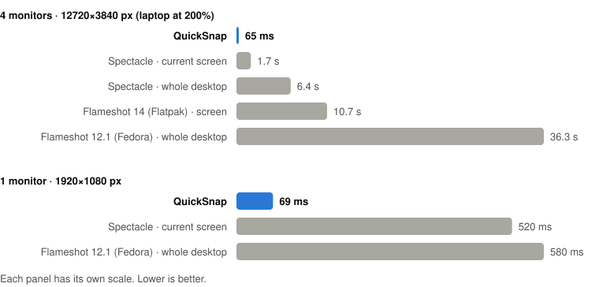
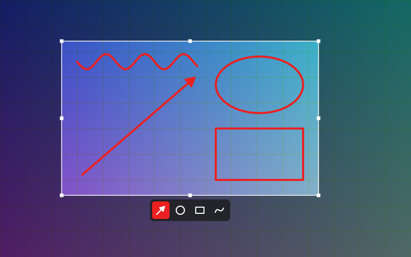

# QuickSnap

**Press Print and start selecting ~70 ms later.** A tiny region-screenshot tool for KDE Plasma
and COSMIC on Wayland: select, draw a red arrow, Ctrl+C. No waiting several seconds for the overlay.

<picture>
  <source media="(prefers-color-scheme: dark)" srcset="docs/benchmark-dark.svg">
  
</picture>



## What it does

| Key / action       | What it does                                                    |
|--------------------|-----------------------------------------------------------------|
| **Print**          | Freeze and dim the screen                                       |
| Drag               | Select a region (drag the edges to resize)                      |
| Right-click        | Select the window under the cursor (on the desktop: the whole screen) |
| Right-click a browser page | Select just the page: no tabs, address bar or bookmarks. Right-click the tabs/toolbar for the whole window |
| Drag inside        | Draw with the current tool, in red                              |
| 1/A · 2/C · 3/R · 4/P | Arrow (default) · circle · rectangle · free draw (or click the tool bar) |
| **Ctrl+C** / Enter | Copy to the clipboard                                           |
| **Ctrl+S**         | Save to `~/Pictures/Screenshot_<date>_<time>.png` (your XDG pictures folder) |
| Ctrl+Z             | Undo the last shape                                             |
| Esc                | Cancel                                                          |

That's all of it. No settings, no manual.

## Why the others make you wait

Both popular tools do real work *after* you press the key, and the work grows with your total
screen area. On a laptop at 200% plus three external monitors, the desktop KWin hands out is
12720×3840 pixels (49 megapixels).

**Flameshot** on Wayland can't read the screen itself, so it asks
[xdg-desktop-portal](https://flatpak.github.io/xdg-desktop-portal/docs/doc-org.freedesktop.portal.Screenshot.html)
for a screenshot. The portal has KWin render every screen, **encodes the whole desktop as one PNG
file**, and returns its path. Flameshot then **decodes that PNG again** and opens a window across
all monitors. Compressing and decompressing 49 megapixels takes seconds. The Flatpak build adds a
sandbox on top, and the Fedora build (12.1) crashed in single-screen mode on this setup.

**Spectacle** is a full Qt/QML app that **starts from scratch on every press**. Just loading it
(`spectacle --version`) takes ~1 s here. Then it captures every screen and builds its overlay.
Its whole-desktop PNG took 6.4 s, almost all of it CPU time spent compressing.

**QuickSnap** skips all of that:

1. **Already running.** A small daemon (a systemd user service) owns the Print shortcut through
   KDE's `kglobalaccel`, so pressing the key costs no program startup.
2. **Raw pixels, no PNG.** It calls KWin's `org.kde.KWin.ScreenShot2` directly, gets raw pixels
   through a pipe, and dims them with all CPU cores. It encodes a PNG only after you press
   Ctrl+C/S, in the background, after the overlay is gone.
3. **The screen you're looking at first.** KWin reads screens back on its main thread, so asking
   for all of them at once makes every one wait. QuickSnap captures the screen under the mouse
   alone (~20–40 ms), shows it, and only then fetches the other screens one by one.
4. **One layer-shell surface per screen**, drawn in software with
   [tiny-skia](https://github.com/RazrFalcon/tiny-skia). No toolkit to load.

On **COSMIC** there is no KWin to ask, so QuickSnap uses the `ext-image-copy-capture-v1`
Wayland protocol instead: all screens are copied into shared memory at once (~25 ms for the
first, ~50 ms for three 1080p screens). COSMIC's own shortcut settings run `quicksnap capture`
on Print.

## Benchmarks

Fedora 41, KDE Plasma 6.4.4, KWin 6.4.4. AMD Ryzen (Phoenix) laptop with an NVIDIA GTX 1650 SUPER
driving the external screens.

| Setup | Tool | Measured | Runs |
|---|---|---|---|
| 4 monitors (12720×3840) | **QuickSnap** | **overlay visible after 63–68 ms** | 63, 67, 68, 65 ms |
| | Spectacle 6.4.4 | capture current screen: 1.55–1.89 s | 1.55, 1.89 s |
| | Spectacle 6.4.4 | capture whole desktop (PNG): 6.4 s | 6.40 s (6.28 s CPU) |
| | Flameshot 14.0.0 (Flatpak) | capture screen: 10.7–11.4 s | 10.7, 11.4 s |
| | Flameshot 12.1.0 (Fedora) | capture whole desktop: 36.3 s | 36.3 s |
| 1 monitor (1920×1080) | **QuickSnap** | **overlay visible after 69 ms (median)** | 58–98 ms, 15 runs |
| | Spectacle 6.4.4 | capture current screen: 520 ms (median) | 1.04, 0.62, 0.53, 0.51, 0.52 s |
| | Flameshot 12.1.0 (Fedora) | capture whole desktop: 490–660 ms | 0.66, 0.49 s |

**What is measured:**
- **QuickSnap:** from the daemon receiving the trigger to the compositor presenting the first
  overlay frame (its frame callback), read from its own log.
- **Spectacle and Flameshot:** a non-interactive capture to a file. Their region overlay can only
  appear *after* that capture, so their real "ready to select" time is at least this long.
- With one screen everyone is fast, but QuickSnap is still ~7× quicker. With several large or
  scaled screens the others slow to seconds, while QuickSnap stays at ~65 ms because it shows
  your screen before touching the rest.

Run it yourself (it briefly dims your screens 15 times):

```sh
scripts/bench.sh        # QuickSnap, Spectacle and Flameshot, whatever is installed
quicksnap bench         # capture timings per screen without showing anything
```

## Install

Needs KDE Plasma 6 or COSMIC on Wayland, `wl-clipboard` (for `wl-copy`) and `libxkbcommon`.

| Distro | Install the dependencies |
|---|---|
| Fedora | `sudo dnf install wl-clipboard libxkbcommon` (add `libxkbcommon-devel gcc` to build from source) |
| Arch / CachyOS | `sudo pacman -S wl-clipboard libxkbcommon` |

**From a release** (x86_64, glibc 2.35 or newer, so Fedora 36+, Ubuntu 22.04+, Arch):

```sh
tar xf quicksnap-*-x86_64-linux.tar.gz
cd quicksnap-*-x86_64-linux
./install.sh
```

**From source** (Rust 1.87+): `./install.sh` in a clone builds with `cargo build --release`.
`scripts/release.sh` builds the release tarball in a Debian 12 container (Podman or Docker) so it
doesn't depend on the build machine's newer glibc.

`install.sh` puts the binary in `~/.local/bin`. It adds a desktop file (KWin only gives
screenshots to programs whose desktop file asks for `org.kde.KWin.ScreenShot2`), and enables the
`quicksnap` user service so it starts at every login. It also moves Spectacle's region capture to
Meta+Shift+Print so Print is free. You can rebind Print in System Settings → Keyboard → Shortcuts
→ QuickSnap.

On COSMIC (detected from `XDG_CURRENT_DESKTOP`) it instead adds Print → `quicksnap capture` to
`~/.config/cosmic/com.system76.CosmicSettings.Shortcuts/v1/custom`, which overrides the default
screenshot binding, and moves COSMIC's screenshot tool to Super+Shift+Print. An existing file is
backed up next to it first. Change it in Settings → Keyboard → Keyboard Shortcuts.

Logs: `journalctl --user -u quicksnap`. Set `QUICKSNAP_DEBUG=1` on the service for per-screen
timings.

### Uninstall

```sh
systemctl --user disable --now quicksnap
rm ~/.local/bin/quicksnap ~/.local/share/applications/quicksnap.desktop \
   ~/.config/systemd/user/quicksnap.service
```

On COSMIC also remove the two `Print` lines from
`~/.config/cosmic/com.system76.CosmicSettings.Shortcuts/v1/custom`.

## How right-click on a browser works

Wayland apps can't see other windows, so on each capture QuickSnap loads a small KWin script
that reports the visible window frames and classes. For browsers (Brave, Chrome/Chromium, Firefox,
Vivaldi, Edge, Opera, LibreWolf, Floorp, Zen) it finds the page in the captured pixels: toolbars
are drawn in a few perfectly flat colors, and the page starts at the first full-width edge below
which those colors stop. If it can't tell, for example with fullscreen video, you get the whole
window.

On COSMIC the window frames come from the compositor's `zcosmic_toplevel_info_v1` protocol
instead. It doesn't tell which window is on top, so where windows overlap the focused one wins,
then the smaller one.

## Limits

- KDE Plasma 6 or COSMIC on Wayland only (KWin's screenshot API or ext-image-copy-capture, and
  layer-shell).
- A selection stays on one monitor.
- Right-click within ~100 ms of pressing Print may select the whole screen, because the window
  list hasn't arrived yet.

## License

MIT
